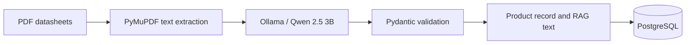
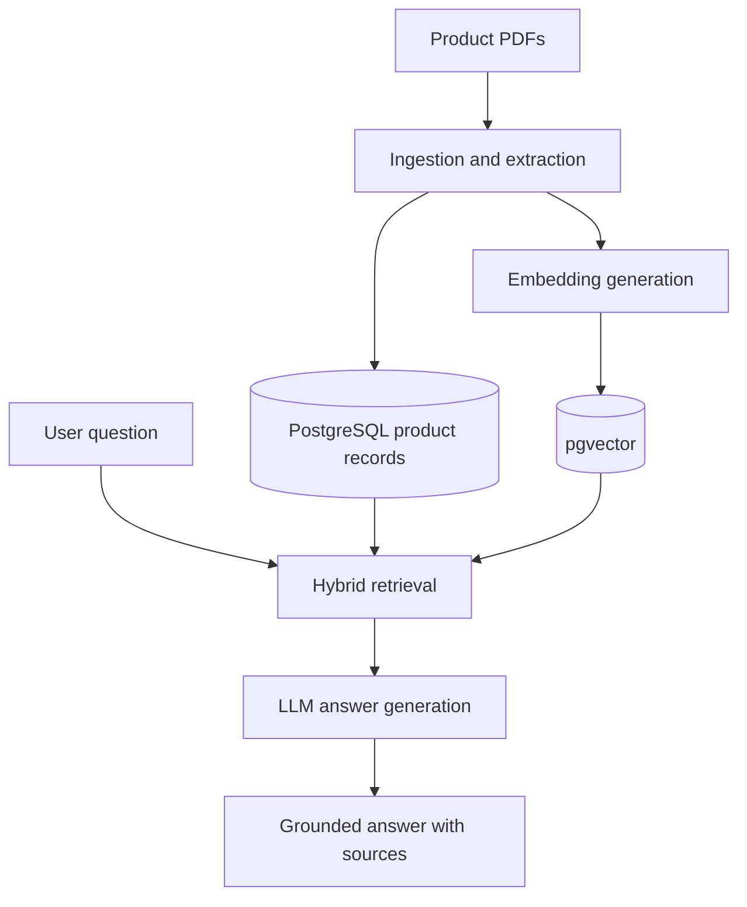

# SpecMind

Transforming technical documentation into searchable, actionable product knowledge.

SpecMind is a learning-oriented RAG (Retrieval-Augmented Generation) project for French logistics product datasheets. It converts PDFs into structured product records and will progressively add semantic search and grounded question answering.

## Current progress

**Phase 1: PDF ingestion and structured extraction — implemented in code.**

The ingestion pipeline discovers PDFs, extracts their text, uses a local LLM to extract product information, validates the output, and persists the results in PostgreSQL.



| Feature | Status |
| --- | --- |
| PDF discovery and text extraction | Implemented |
| Folder-based category assignment | Implemented |
| Local LLM structured extraction | Implemented |
| Product schema validation | Implemented |
| PostgreSQL persistence and upsert | Implemented |
| RAG-ready text generation | Implemented |
| Extraction quality evaluation | Planned |
| Embeddings and vector indexing | Planned |
| Hybrid retrieval | Planned |
| Grounded answer generation and citations | Planned |

Implementation status refers to the source code, not verified end-to-end execution or extraction accuracy.

## Technology stack

- **Python** — ingestion and orchestration
- **PyMuPDF** — PDF text extraction
- **Ollama / `qwen2.5:3b`** — local structured information extraction
- **Pydantic** — schema definition and validation
- **PostgreSQL 17 / pgvector Docker image** — structured storage and future vector search
- **psycopg** — database access

## Repository structure

```text
SpecMind/
├── docker-compose.yml
├── requirements.txt
├── README.md
├── LEARN.md
└── src/
    ├── database/
    │   ├── connection.py
    │   └── repository.py
    └── ingestion/
        ├── pdf_loader.py
        ├── product_extractor.py
        ├── schemas.py
        └── pipeline.py
```

Local input documents are expected under `data/PDFs/`, organized into category folders: `Palettes`, `Caisses`, `Pallox`, `Poubelles`, `Scelle`, and `Accessoires`.

## Product data model

Each product record stores:

| Field | Purpose |
| --- | --- |
| `name` | Exact product name or identifier |
| `category` | Product category derived from the source folder |
| `description` | Original French description, when present |
| `specifications` | Technical properties stored as JSONB with original labels, values and units |
| `source_file`, `source_path` | Source document identification |
| `raw_text` | Original extracted PDF text |
| `rag_text` | Standardized text representation for future retrieval |

The pipeline skips existing source paths by default and supports forced reprocessing through `run_pipeline(force=True)`. The database upsert uses `source_path` as its conflict key.


## Next steps

### Phase 2 — Extraction quality and reproducibility

- [ ] Add missing dependencies to `requirements.txt`.
- [ ] Add database initialization or migrations and an example environment configuration.
- [ ] Build a representative golden dataset from the original PDFs.
- [ ] Evaluate product identification, specification completeness and correctness.
- [ ] Add automated tests and improve handling of changed documents and scanned PDFs where needed.

### Phase 3 — Embeddings and retrieval

- [ ] Select and evaluate an embedding model suitable for French technical text.
- [ ] Enable the pgvector extension and define vector storage.
- [ ] Generate embeddings from `rag_text` and preserve source identifiers.
- [ ] Implement top-k semantic similarity search.
- [ ] Add structured SQL filtering and exact product identifier lookup.
- [ ] Normalize numeric values and units where required for reliable technical comparisons.
- [ ] Evaluate retrieval using a golden question set and Recall@k.

### Phase 4 — RAG question answering

- [ ] Retrieve relevant product records for a natural-language query.
- [ ] Generate answers grounded in retrieved evidence.
- [ ] Return source-document references and handle insufficient evidence.
- [ ] Evaluate answer correctness, faithfulness and citation accuracy.

## Target architecture



Hybrid retrieval is the proposed direction: semantic similarity handles natural-language intent, while structured SQL filters support exact product attributes and technical constraints.

## Learning goals

Understand the complete RAG lifecycle: document ingestion, structured extraction, embeddings, vector search, hybrid retrieval, context construction, grounded generation and evaluation.

See [LEARN.md](LEARN.md) for learning notes.

## License

[MIT](LICENSE)
